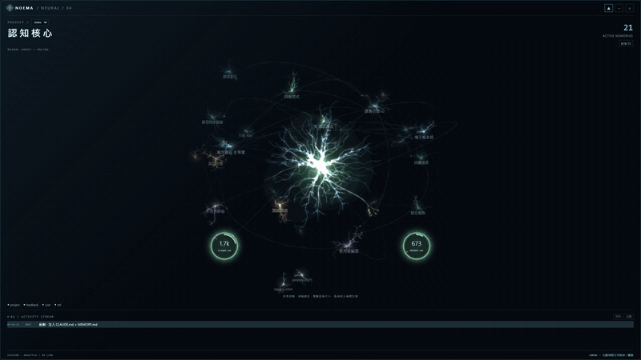

# Noema

**English** | [繁體中文](README.zh-TW.md)

**A live window into Claude Code's memory.**

Noema is a small desktop window that shows, in real time, which of Claude Code's memory files are being read, created, edited or deleted, and helps you keep that memory lean.



> Full-quality demo: [`docs/noema-demo.mp4`](docs/noema-demo.mp4) (29 s, 1920×1080, sample data)

Claude Code keeps per-project memory as Markdown files under `~/.claude/projects/<project>/memory/`, plus a global `~/.claude/CLAUDE.md`. These files are injected into every session or read on demand, but you normally never see that happen. Noema makes it visible.

*The name comes from phenomenology: a noema is "the object as it is thought about."*

## What you see

- **A 3D neural network**: Claude itself is the large neuron at the center. It breathes while idle, swells when memory is touched, and takes on the color of the latest event. Drag to rotate, scroll to zoom, double-click empty space to reset; it never spins on its own.
- **Every memory is a neuron**: each memory file grows its own procedurally generated neuron (a minimum-spanning-tree morphology after Cuntz et al., 2010, with tapering branches), and always keeps the same shape and place.
- **Fully wired**: the central neuron's dendrites reach out to every active memory; `[[wiki links]]` are axons between memories; neighboring memories touch through fine synapses. Archived memories sink to the bottom and are disconnected from the center.
- **Only loaded memories are bright**: memories read or written since the last boot injection (that is, the ones actually in Claude's context right now) are bright; everything else stays dim until it's touched.
- **Every event lights up the real wiring**: the connection from the central neuron to the memory lights up, and each kind of event moves differently.

  | Event | Color | What happens |
  |---|---|---|
  | Read | green | the whole connection lights up and glows with a slow breathing pulse, then fades; faint signals spread on to linked memories |
  | Create | blue | the connection stretches out from the center, thinning as it goes; a new neuron sprouts at the tip, the line springs back, and a ring of light spreads out |
  | Modify | gold | the whole connection glows and breathes, and ripples spread around the neuron |
  | Delete | red | the connection shoots out, pulls taut and trembles, then snaps back to the center like a rubber band; the neuron turns red, its branches retract, and it scatters into embers |

- **Click a memory to read it**: clicking a neuron opens it in a reader drawer that slides in from the left and pushes the rest of the window aside, so nothing is covered. The selected memory's connection keeps glowing with a faint current running through it. Follow a `[[link]]` in the reader and the glow follows. Click empty space (or press Esc) to close the drawer and clear the selection.
- **Boot injection as two gauges**: `CLAUDE.md` and `MEMORY.md`, which are injected at the start of every session, are the two round gauges below the central neuron. They aren't wired into the network; they glow when read or written. Each arc shows the file's approximate token count against the budget, a red tick marks where the total would go over, and both turn red when you're over budget.
- **Activity stream**: a timeline of every memory event in the current session. Click any entry to open that memory in the reader drawer.
- **Light or dark**: the ◐ button in the title bar switches between the dark theme and a light one, where the glow turns into gray ink. Noema remembers your choice.
- **Archive count and toggle**: the archive count sits under the memory count at the top right; click it to show or hide archived memories.
- **Archive, delete or purge from the window**: right-click a neuron, or use the buttons in the reader. You can archive or permanently delete an active memory, and purge an archived one. Every action asks for confirmation first, with focus on "Cancel", and backs the file up before touching it. It also tidies the index: archiving moves the `MEMORY.md` line to `archive/ARCHIVE.md`, while deleting and purging remove the line. `CLAUDE.md` and `MEMORY.md` themselves can't be touched.
- **Auto-follow**: when you start or resume a Claude Code session, Noema switches to that project's memory automatically.

## Sleep: keeping memory lean (optional)

Memory tends to bloat over time with stale paths, finished progress notes and duplicates. The included **Sleep** skill gives a project's memory a "night's sleep", and Noema stages each phase:

1. **Sleep**: backs up the memory folder. The whole window dims, but you can still tell loaded memories from the rest.
2. **Scan**: rule-based checks run first. They find local paths that no longer exist, notes past their `review:` date, memories never read in the transcript window ("cold"), and orphans with no links. As the scan reaches each memory (archived ones excluded), its connection lights up and stays lit until the scan ends, and flagged memories get marks. **⚠ hot** marks memories that are read often *and* look wrong, which are the most dangerous kind.
3. **Propose**: Claude then looks for duplicates and notes that can be compressed, and lists proposals grouped by reason. You approve them in batches.
4. **Apply**: fixes, compressions, merges and archiving, each shown as the usual colored signals.
5. **Wake**: the central neuron flares back up and shows the boot-injection token count before and after.

**Purge** permanently deletes files, but only from `archive/` and only when you explicitly ask. In Noema the archived neuron is flooded with red light until it glows, then burns away, but only after the file is actually gone. If the command is denied, the neuron is restored.

Sleep never deletes anything outside `archive/`. Stale memories are *moved* to `archive/`, and every Sleep run starts with a full backup under `%LOCALAPPDATA%\Noema\sleep\backup\`.

## Install

**Requirements**

- **Windows 10/11 (x64).** macOS and Linux are not supported.
- **Microsoft Edge WebView2 Runtime.** It ships with Windows 11 and current Windows 10. If it's missing, Noema shows a dialog with a link to [download it](https://developer.microsoft.com/microsoft-edge/webview2/).
- **Claude Code running natively on Windows.** If you run Claude Code inside WSL, its memory lives in the Linux filesystem, and Noema can't see it.
- **Claude Code's memory folder** (`~/.claude/projects/<project>/memory/`, where Claude saves memories with a `MEMORY.md` index). Noema visualizes that folder plus your global `~/.claude/CLAUDE.md`. It does *not* read `CLAUDE.md` files inside your repositories. If a project has no memory folder yet, Noema says so instead of showing an empty window.

No Visual C++ redistributable is needed; the runtime is linked into the executable.

### Download

Grab `noema.exe` from the [latest release](../../releases/latest) and run it.

> **"Windows protected your PC"?** The executable isn't code-signed yet, so SmartScreen may warn the first time you run it. Click **More info → Run anyway**. You can always build it yourself from source instead (see below).

### Build from source

```bash
cd app
cargo build --release
```

The binary is at `app/target/release/noema.exe`. The UI (`app/ui/index.html`) is embedded at compile time, so rebuild after changing it.

### Install the Sleep skill (optional)

Copy `skill/sleep/` to `~/.claude/skills/sleep/`. Then, in Claude Code, say "sleep" (or `/sleep`) to run it on the current project's memory.

## Usage

| Action | How |
|---|---|
| Show / hide | `Ctrl+Alt+N`, or the tray icon |
| Rotate the network | drag on empty space (or Shift + scroll) |
| Zoom | scroll; double-click empty space to reset |
| Read a memory | click a neuron or its name, a gauge, or an activity entry (opens the left drawer) |
| Close the reader | click empty space, press Esc, or the × button |
| Show / hide archived memories | click the archive count at the top right |
| Archive / delete / purge a memory | right-click the neuron, or use the buttons in the reader (always confirmed) |
| Switch light / dark theme | title-bar button ◐ |
| Pin on top / collapse to capsule | title-bar buttons ▲ and − |
| Switch project | the project dropdown (it also auto-follows active sessions) |

## How it works

- A Rust core (`app/src/core.rs`) watches the current project's `memory/` folder and the session transcripts (`*.jsonl`) with filesystem notifications. It does not use hooks, and it does not touch `settings.json`.
- Each `tool_use` in a transcript is classified:
  - `Read` is a read.
  - `Write` to a file that didn't exist is a create. Any other `Write`, and every `Edit`, is a modify.
  - Shell `rm` / `mv` / `Remove-Item` on a memory file is a delete.
  - The Sleep script's own command line is recognised as a phase marker.
- The UI (`app/ui/index.html`) is a single HTML file rendered in WebView2 via [tao](https://github.com/tauri-apps/tao) + [wry](https://github.com/tauri-apps/wry).
- Window position and state are saved in `%LOCALAPPDATA%\Noema\state.json`.

## Privacy

Noema is **local**. It makes no network requests and sends nothing anywhere.

It only reads your memory and transcript files, with one exception: when you archive, delete or purge a memory from the window and confirm it. Before any such change, the file is backed up to `%LOCALAPPDATA%\Noema\trash\<project>\`.

Apart from that, the only file Noema writes is its own window state. The optional Sleep skill writes its report and backups to `%LOCALAPPDATA%\Noema\sleep\`.

## Known limitations

- The interface is currently in Traditional Chinese. English is planned ([#1](https://github.com/youllook/noema/issues/1)).
- Only one project's memory is shown at a time, and several Noema windows can be opened at once.
- The Sleep skill needs Node.js. Its instructions are in Chinese, and a scan reads every transcript in the project, so it can be slow when the transcripts add up to several GB.

## License

[MIT](LICENSE)

*Noema is an independent project and is not affiliated with or endorsed by Anthropic. "Claude" and "Claude Code" are trademarks of Anthropic.*
