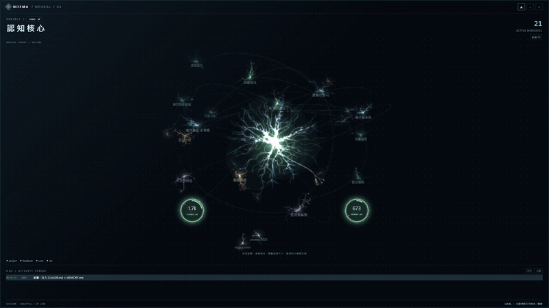

# Noema

[English](README.md) | **繁體中文**

**Claude Code 記憶的即時檢視窗。**

Noema 是一個小小的桌面視窗。它會即時畫出 Claude Code 正在讀取、新增、修改或刪除哪些記憶檔，也能幫你把記憶維持精簡。



> 完整畫質示範：[`docs/noema-demo.mp4`](docs/noema-demo.mp4)（20 秒，1920×1080，示範資料）

Claude Code 會把每個專案的記憶存成 Markdown 檔，放在 `~/.claude/projects/<專案>/memory/`，另外還有一份全域的 `~/.claude/CLAUDE.md`。這些檔案有些在每次對話開始時自動注入，有些在需要時才讀取，但你平常看不到這些過程。Noema 把它們即時畫出來。

*名字取自現象學：noema 指的是「被思考的對象」。*

## 你會看到什麼

- **門縫**：中央一道細細的光，代表 Claude 本身。平常緩慢呼吸，記憶被碰到時打開，顏色跟著最新事件變化。
- **記憶雲**：每個記憶檔是一張卡片，排成 3D 記憶雲。用滾輪或拖曳可以旋轉，它不會自己轉。
- **四色光束**：

  | 事件 | 顏色 | 畫面 |
  |---|---|---|
  | 讀取 | 綠 | 光束從門縫流向卡片 |
  | 新增 | 藍 | 新卡從光裡浮現 |
  | 修改 | 金黃 | 細光束上跑短脈衝 |
  | 刪除 | 紅 | 光束打完，卡片消失 |

- **只凸顯正在用的記憶**：被碰到的卡片會放大、變得不透明、浮到最前面。關聯線（`[[wiki 連結]]` 和索引連結）*只*畫這些卡片的，所以一眼就看得出哪些記憶正在被使用。
- **門把＝開機注入**：`CLAUDE.md` 和 `MEMORY.md` 會在每次對話開始時注入，它們是門縫兩側的兩個光圈。光圈旁顯示約略的 token 數，滑過去可以看到合計和預算線，超過預算時光圈轉紅。
- **活動紀錄**：這次對話裡所有的記憶事件依時間列出。點任一筆，就會在內建的 Markdown 閱讀器裡打開那條記憶。
- **直接在視窗裡封存、刪除、銷毀**：在卡片上按右鍵，或用閱讀器裡的按鈕。現役記憶可以封存或永久刪除，封存的記憶可以銷毀。
  - 每次都會先跳確認框，預設焦點在「取消」。
  - 動手前會先備份那個檔。
  - 會順手整理索引：封存時把 `MEMORY.md` 裡那行搬到 `archive/ARCHIVE.md`，刪除和銷毀時直接拿掉那行。
  - `CLAUDE.md` 和 `MEMORY.md` 本身不能被動到。
- **自動跟隨**：開始或接續一段 Claude Code 對話時，Noema 會自動切到那個專案的記憶。

## Sleep：讓記憶保持精簡（選用）

時間一久，記憶會累積失效的路徑、做完的進度紀錄和重複的內容。附帶的 **Sleep** 技能會讓一個專案的記憶「睡一覺」，Noema 會同步演出每個階段：

1. **入睡**：備份記憶資料夾，畫面變暗。
2. **掃描**：先跑規則檢查，找出本機路徑已不存在、過了 `review:` 複查日、在對話紀錄裡從沒被讀過（冷）、沒有任何連結的孤兒記憶。一道光幕掃過記憶雲，留下標記。**⚠ 熱**代表常被讀取、內容卻可能已經錯了，這是最危險的一種。
3. **提案**：接著由 Claude 找出重複和可以壓縮的條目，依原因分組列出建議，由你分批核准。
4. **執行**：改正、壓縮、合併、封存，每一步都用平常的彩色光束顯示。
5. **醒來**：門縫重新打開，顯示開機注入 token 的前後變化。

**銷毀**會永久刪除檔案，但只限 `archive/` 裡的檔，而且要你明確下令才會執行。在 Noema 裡，卡片會被紅光注入到發亮，確認檔案真的刪掉之後才燒成灰燼。如果指令被拒絕，卡片會還原。

Sleep 不會刪 `archive/` 以外的東西。過時的記憶是*搬進* `archive/`，而且每次 Sleep 開始時都會先完整備份到 `%LOCALAPPDATA%\Noema\sleep\backup\`。

## 安裝

**需求**

- **Windows 10/11（x64）**。不支援 macOS 和 Linux。
- **Microsoft Edge WebView2 Runtime**。Windows 11 和較新的 Windows 10 已內建。沒有的話，Noema 會跳出說明並附上[下載連結](https://developer.microsoft.com/microsoft-edge/webview2/)。
- **Claude Code 直接跑在 Windows 上**。如果你在 WSL 裡跑 Claude Code，它的記憶存在 Linux 檔案系統裡，Noema 看不到。
- **Claude Code 的記憶資料夾**（`~/.claude/projects/<專案>/memory/`，Claude 會在這裡存記憶，並用 `MEMORY.md` 當索引）。Noema 顯示的是這個資料夾和全域的 `~/.claude/CLAUDE.md`，*不會*讀你 repo 裡的 `CLAUDE.md`。如果專案還沒有記憶資料夾，Noema 會顯示說明，不會是一片空白。

不需要另外安裝 Visual C++ 可轉散發套件，執行階段已經編進執行檔。

### 下載

到[最新版本](../../releases/latest)下載 `noema.exe`，直接執行。

> **跳出「Windows 已保護您的電腦」？** 執行檔還沒有數位簽章，第一次執行時 SmartScreen 可能會警告。點**其他資訊 → 仍要執行**即可。你也可以自己從原始碼編譯（見下方）。

### 從原始碼編譯

```bash
cd app
cargo build --release
```

執行檔在 `app/target/release/noema.exe`。介面（`app/ui/index.html`）是在編譯時嵌進去的，改完要重新編譯。

### 安裝 Sleep 技能（選用）

把 `skill/sleep/` 複製到 `~/.claude/skills/sleep/`。之後在 Claude Code 裡說「入睡」（或 `/sleep`），就會對目前專案的記憶執行。

## 使用方式

| 想做的事 | 怎麼做 |
|---|---|
| 顯示／隱藏 | `Ctrl+Alt+N`，或系統匣圖示 |
| 旋轉記憶雲 | 在空白處滾輪或拖曳 |
| 讀一條記憶 | 點卡片、門把，或活動紀錄裡的一筆 |
| 封存／刪除／銷毀記憶 | 在卡片上按右鍵，或用閱讀器裡的按鈕（一律先確認） |
| 置頂／縮成膠囊 | 標題列的 ▲ 和 − |
| 切換專案 | 專案下拉選單（也會自動跟隨正在用的對話） |

## 運作原理

- Rust 核心（`app/src/core.rs`）用檔案系統通知監看目前專案的 `memory/` 資料夾和對話紀錄（`*.jsonl`）。它不用 hook，也不碰 `settings.json`。
- 對話紀錄裡的每個 `tool_use` 會被分類：
  - `Read` 算讀取。
  - `Write` 寫到原本不存在的檔算新增；其他的 `Write` 和所有 `Edit` 都算修改。
  - shell 指令對記憶檔做 `rm`／`mv`／`Remove-Item` 算刪除。
  - Sleep 腳本自己的指令列會被認成階段標記。
- 介面（`app/ui/index.html`）是一個 HTML 檔，透過 [tao](https://github.com/tauri-apps/tao) + [wry](https://github.com/tauri-apps/wry) 在 WebView2 裡顯示。
- 視窗位置和狀態存在 `%LOCALAPPDATA%\Noema\state.json`。

## 隱私

Noema **只在本機運作**，不發出任何網路連線，也不會把資料送到任何地方。

它只讀取你的記憶檔和對話紀錄，唯一的例外是：你在視窗裡確認封存、刪除或銷毀某條記憶的時候。每次動手之前，都會先把那個檔備份到 `%LOCALAPPDATA%\Noema\trash\<專案>\`。

除此之外，Noema 唯一會寫的檔是自己的視窗狀態。選用的 Sleep 技能會把報告和備份寫到 `%LOCALAPPDATA%\Noema\sleep\`。

## 已知限制

- 介面目前只有繁體中文，英文版已在規劃中（[#1](https://github.com/youllook/noema/issues/1)）。
- 一次只顯示一個專案的記憶，而且可以同時開好幾個 Noema 視窗。
- Sleep 技能需要 Node.js。說明是中文，而且掃描時會讀完專案裡所有的對話紀錄，紀錄累積到好幾 GB 時會比較慢。

## 授權

[MIT](LICENSE)

*Noema 是獨立專案，與 Anthropic 沒有關聯，也未獲其背書。「Claude」與「Claude Code」是 Anthropic 的商標。*
